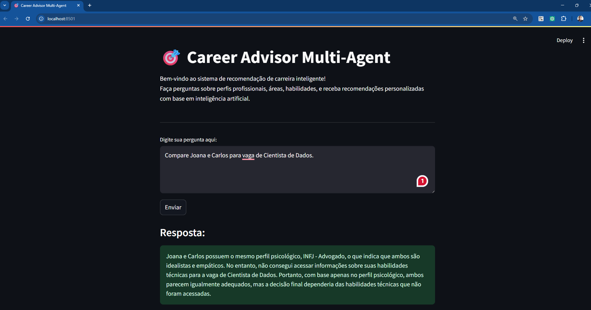
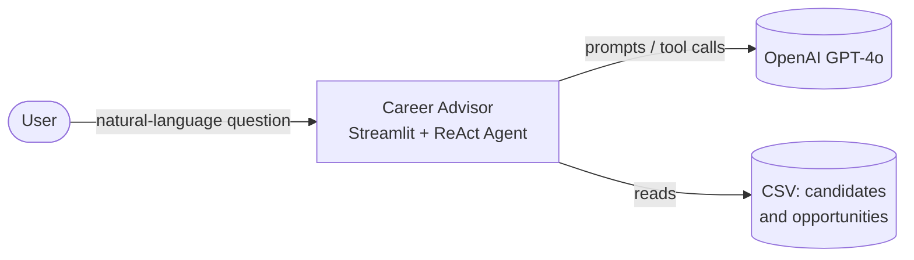
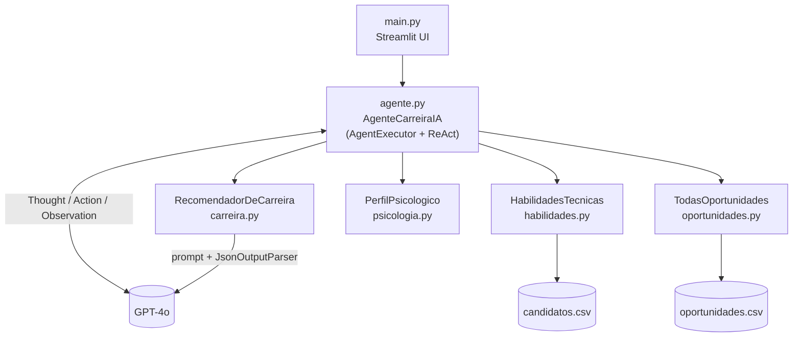
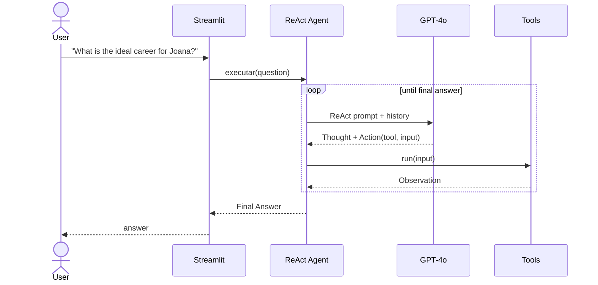

# 💼 career-advisor-multi-agent

An AI agent that recommends careers based on skills, experience, interests and psychological profile, using **LangChain**, **GPT-4o** and a **ReAct** agent that orchestrates specialized tools.



## 🏗️ Architecture

### Context (C4 – level 1)



### Containers and components (C4 – level 2/3)



### Request flow



## 🧭 Architecture decisions

| Decision | Rationale | Trade-off |
|---|---|---|
| **ReAct** agent with isolated tools | Each capability is testable and replaceable; the LLM decides composition | More LLM calls → higher latency and cost per question |
| Data in **CSV** | Zero infrastructure for a prototype | No scale, querying or data governance |
| Tools as `BaseTool` classes | Uniform interface to register new tools | Coupled to the LangChain API (version pinned in `requirements.txt`) |
| `hwchase17/react` prompt from LangChain Hub | Standard, proven prompt | Runtime network dependency; prompt is not versioned in the repo |

## ⚠️ Current state and limitations

This is a **study prototype**. To be transparent about what is real and what is simulated:

- `RecomendadorDeCarreira` uses the LLM to extract the profile, but the suggested area is hard-coded ("Information Technology").
- `HabilidadesTecnicas` and `PerfilPsicologico` return simulated values.
- Only `TodasOportunidades` reads real data (CSV) without simulation.
- There is no automated evaluation, testing or observability.
- Prompts, tool names and sample data are in Portuguese.

## 🚀 Roadmap to production

- [ ] Replace simulated responses with real logic (LLM-based skill extraction with structured output; weighted matching using `PESO_HABILIDADES` and `PESO_INTERESSE`)
- [ ] Migrate to **LangGraph** with explicit state and native tool calling
- [ ] **Evaluation** layer (question dataset + criteria, LLM-as-judge) running in CI
- [ ] **Observability**: tracing (OpenTelemetry/LangSmith), cost and latency per request
- [ ] **Guardrails**: input/output validation, PII protection and bias mitigation
- [ ] Real persistence (PostgreSQL/Azure AI Search) and **Azure OpenAI** support
- [ ] Unit tests for the tools and CI with GitHub Actions

## 📁 Structure

```
├── main.py            # Streamlit UI (entry point)
├── agente.py          # ReAct agent + tool registration
├── carreira.py        # Tool: career area recommendation
├── habilidades.py     # Tool: technical skills
├── psicologia.py      # Tool: psychological profile
├── oportunidades.py   # Tool: job openings list
├── documentos/        # candidatos.csv, oportunidades.csv
└── requirements.txt
```

## ▶️ Running locally

```bash
git clone https://github.com/dgmodesto/career-advisor-multi-agent.git
cd career-advisor-multi-agent
python -m venv venv
venv\Scripts\activate            # Linux/macOS: source venv/bin/activate
pip install -r requirements.txt
echo OPENAI_API_KEY=sk-... > .env
streamlit run main.py
```

Example questions:

- "What is the ideal career for Joana?"
- "Is Carlos a better fit for marketing or product?"
- "Compare Joana and Carlos for a Data Scientist role."

## 🧪 Sample data

`documentos/candidatos.csv`

```csv
NOME,HABILIDADES,EXPERIENCIAS,INTERESSES,TESTE_PSI
Joana,"Python,SQL,Análise","2 anos como Analista","Dados,Ensino","INFJ"
Carlos,"Design,UX,Adobe","1 ano como Estagiário","Criação,Produtos","ENFP"
```

`documentos/oportunidades.csv`

```csv
CARGO,AREA,REQUISITOS,PESO_INTERESSE,PESO_HABILIDADES
Cientista de Dados,TI,"Python,SQL",0.4,0.6
UX Designer,Design,"UX,Adobe",0.5,0.5
```

## 🛠️ Stack

Python 3.10+ · LangChain · OpenAI GPT-4o · Streamlit · pandas · python-dotenv

## 📄 License

MIT
