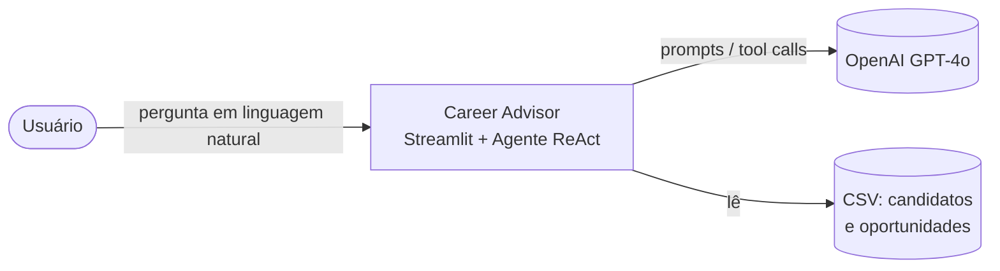
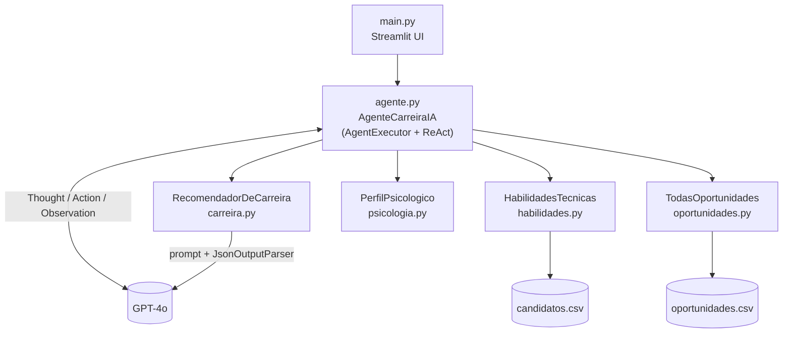
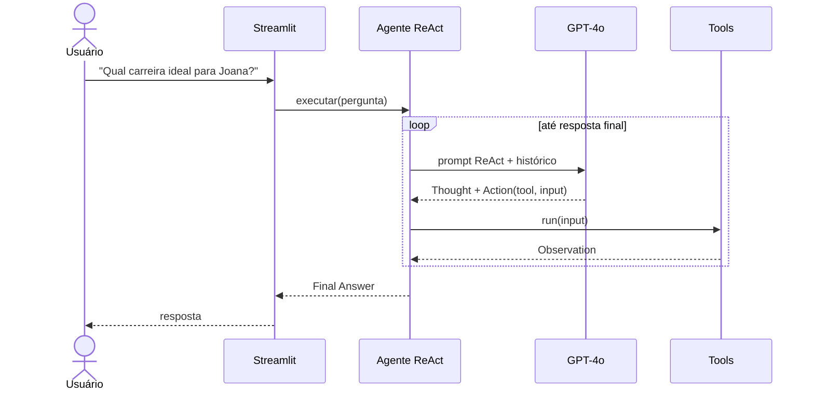

# 💼 career-advisor-multi-agent

Agente de IA que recomenda carreiras a partir de habilidades, experiências, interesses e perfil psicológico, usando **LangChain**, **GPT-4o** e um agente **ReAct** que orquestra ferramentas especializadas.


## 🏗️ Arquitetura

### Contexto (C4 – nível 1)



### Containers e componentes (C4 – nível 2/3)



### Fluxo de uma requisição



## 🧭 Decisões de arquitetura

| Decisão | Motivo | Trade-off |
|---|---|---|
| Agente **ReAct** com tools isoladas | Cada capacidade é testável e substituível; o LLM decide a composição | Mais chamadas ao LLM → maior latência e custo por pergunta |
| Dados em **CSV** | Zero infraestrutura para um protótipo | Sem escala, consultas ou governança de dados |
| Tools como classes `BaseTool` | Interface uniforme para registrar novas ferramentas | Acoplamento à API do LangChain (versão fixada em `requirements.txt`) |
| Prompt `hwchase17/react` via LangChain Hub | Prompt padrão e consolidado | Dependência de rede em tempo de execução e prompt não versionado no repo |

## ⚠️ Estado atual e limitações

Este é um **protótipo de estudo**. Para ser transparente sobre o que é real e o que é simulado:

- `RecomendadorDeCarreira` usa o LLM para extrair o perfil, mas a área sugerida está fixa (“Tecnologia da Informação”).
- `HabilidadesTecnicas` e `PerfilPsicologico` retornam valores simulados.
- Apenas `TodasOportunidades` lê dados reais (CSV) sem simulação.
- Não há avaliação automatizada, testes nem observabilidade.

## 🚀 Roadmap para produção

- [ ] Substituir as respostas simuladas por lógica real (extração de habilidades via LLM com saída estruturada; matching ponderado usando `PESO_HABILIDADES` e `PESO_INTERESSE`)
- [ ] Migrar para **LangGraph** com estado explícito e *tool calling* nativo
- [ ] Camada de **avaliação** (dataset de perguntas + critérios, LLM-as-judge) rodando no CI
- [ ] **Observabilidade**: tracing (OpenTelemetry/LangSmith), custo e latência por requisição
- [ ] **Guardrails**: validação de entrada/saída, proteção de dados pessoais (PII) e mitigação de vieses
- [ ] Persistência real (PostgreSQL/Azure AI Search) e suporte a **Azure OpenAI**
- [ ] Testes unitários das tools e CI com GitHub Actions

## 📁 Estrutura

```
├── main.py            # UI Streamlit (ponto de entrada)
├── agente.py          # Agente ReAct + registro das tools
├── carreira.py        # Tool: recomendação de área
├── habilidades.py     # Tool: habilidades técnicas
├── psicologia.py      # Tool: perfil psicológico
├── oportunidades.py   # Tool: lista de vagas
├── documentos/        # candidatos.csv, oportunidades.csv
└── requirements.txt
```

## ▶️ Como executar

```bash
git clone https://github.com/dgmodesto/career-advisor-multi-agent.git
cd career-advisor-multi-agent
python -m venv venv
venv\Scripts\activate            # Windows (Linux/macOS: source venv/bin/activate)
pip install -r requirements.txt
echo OPENAI_API_KEY=sk-... > .env
streamlit run main.py
```

Exemplos de perguntas:

- "Qual carreira ideal para Joana?"
- "Carlos é melhor para marketing ou produto?"
- "Compare Joana e Carlos para vaga de Cientista de Dados."

## 🧪 Dados de exemplo

`documentos/candidatos.csv`

```csv
NOME,HABILIDADES,EXPERIENCIAS,INTERESSES,TESTE_PSI
Joana,"Python,SQL,Análise","2 anos como Analista","Dados,Ensino","INFJ"
Carlos,"Design,UX,Adobe","1 ano como Estagiário","Criação,Produtos","ENFP"
```

`documentos/oportunidades.csv`

```csv
CARGO,AREA,REQUISITOS,PESO_INTERESSE,PESO_HABILIDADES
Cientista de Dados,TI,"Python,SQL",0.4,0.6
UX Designer,Design,"UX,Adobe",0.5,0.5
```

## 🛠️ Stack

Python 3.10+ · LangChain · OpenAI GPT-4o · Streamlit · pandas · python-dotenv

## 📄 Licença

MIT
